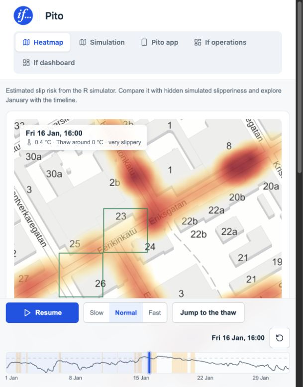

# Pito — If keeps you on your feet

**Pito turns community hazard reports into a shared risk map and actionable maintenance priorities.** It is a proposed feature for the If app, paired with a prevention dashboard for If. Pito means *grip* in Finnish.

Winter hazards can change faster than maintenance teams can inspect every pavement. Pito explores how customer reports, phone motion signals and weather could help identify where attention is needed, warn pedestrians and cyclists, and coordinate with the organisations responsible for maintenance.

This hackathon prototype demonstrates the full **report → hotspot → maintenance → verification** loop. It also includes a simulation for exploring how targeted gritting might compare with a fixed maintenance rotation.

[](https://johottaja.github.io/if-hackathon-project/demo.html?t=376#heatmap)

*Heatmap at 16 January, 16:00 in the synthetic replay. Colours show estimated slip risk; green outlines mark simulated gritting.*

## Start here: a five-minute tour

[Open the browser demo](https://johottaja.github.io/if-hackathon-project/demo.html#heatmap). It runs without an account, a phone or a local API.

**Model papers (PDF):** [English](paper_en.pdf) · [Finnish](paperi_fi.pdf). They define the simulator mathematically and prove the conditions under which phone slip detections lower expected falls compared with the best gritting policy that ignores them.

1. **Heatmap:** move through the timeline to see estimated slip risk around Eskelinkatu, Turku. Compare the estimate with the optional hidden simulation truth layer and inspect gritting activity.
2. **Simulation:** watch the simulated January 2026 unfold. Compare Pito-targeted gritting with the same crew following a fixed rotation. The difference can be negative: targeted intervention does not win at every moment.
3. **Pito app:** explore the embedded customer app and its view of current estimated risk.
4. **If operations:** inspect recommended blocks, supporting signals and gritting decisions. The euro estimate uses adjustable assumptions; it is an illustration, not measured savings.
5. **If dashboard:** try the report and maintenance workflow directly in your browser. On GitHub Pages, changes stay in that browser and **Reset** restores the scenario. To share reports and maintenance updates between a phone and dashboard, run the connected demo below.

## What we built

- **Customer app:** an Expo / React Native prototype with a community hazard map, guided reporting, a simulated fall check-in, saved drafts and maintenance updates. A possible-fall trigger asks “Did you fall?”; only explicit submission publishes a report. Confirmed falls and hazard reports without a fall are counted separately.
- **If prevention dashboard:** a React web app for reviewing aggregate reports, identifying hotspots, recording maintenance assignments and following completion and verification. Report history remains visible, and a new report can reopen a location.
- **Simulation and risk visualisation:** an R simulator and interactive browser replay that combine simulated pedestrian events, phone detections and maintenance with measured weather. The browser demo embeds the mobile app’s web build on the shared timeline.

For customers, the intended value is clearer information about nearby hazards and feedback after reporting. For If, the opportunity is earlier prevention, better coordination and more useful everyday engagement. Reduced injuries and claims costs remain hypotheses to validate.

If’s role is coordination and prioritisation. Road owners, housing companies and their maintenance partners remain responsible for interventions; real assignments would require agreements.

## What is real, simulated or proposed?

**Implemented:** explicit reporting, shared demo state, aggregate hotspot review, maintenance status transitions, retained history, and the interactive simulation replay.

**Simulated:** all pedestrians, falls, phone detections, reports, maintenance partners and interventions. The browser replay uses measured FMI weather from Turku Artukainen, but its outcomes are simulated. The connected Linnankatu demo instead uses a fixed, illustrative weather baseline with no live weather feed. These are separate scenarios.

**Proposed:** on-device motion detection, live weather ingestion, historical claims analysis, real partner notifications and integration into the actual If app. The prototype does not detect a physical slip or send external maintenance requests.

Completed or verified maintenance does **not** guarantee current safety. Simulation results do **not** demonstrate real-world injury reduction or savings.

The product privacy commitment is on-device detection, no stored routes, and no use of Pito data for individual pricing or claims decisions. The demo uses synthetic reports without customer identities or personal movement histories; production consent, retention and enforcement still need design and review.

## Run locally

Use Node.js **22.13 or newer**. Install each application’s dependencies in its own directory:

```sh
cd dashboard
npm ci
cd ../mobile
npm ci
```

### Browser simulation

Build from the repository root:

```sh
cd dashboard
npm run build:demo
npm run preview
```

Open the preview URL printed in the terminal, then `/demo.html#heatmap`. This builds both the dashboard and the embedded mobile web app. The checked-in simulation export is included; R is only needed to regenerate it.

### Connected phone and dashboard demo

Start these in three separate terminals, each from the repository root:

```sh
# Terminal 1: shared synthetic API
cd dashboard
npm run api
```

```sh
# Terminal 2: dashboard
cd dashboard
npm run dev
```

```sh
# Terminal 3: customer app — replace with your computer's LAN address
cd mobile
EXPO_PUBLIC_API_URL=http://192.168.1.123:3000 npm start -- --clear
```

Open the Vite URL with `?view=dashboard` to reach the connected dashboard. The phone and computer must share a network; use Expo Go compatible with SDK 57. For an iOS simulator on the same Mac, use `http://localhost:3000`. Without `EXPO_PUBLIC_API_URL`, the mobile app runs standalone. Restart Expo after changing the variable.

The unauthenticated API is intended for synthetic data on a trusted local demo network. Stop it after the demonstration.

#### Walk through the prevention loop

1. In the dashboard, expand **Scenario controls**, choose **Reset**, and select **Linnankatu pavement**. It starts with 4 confirmed-fall reports and 5 hazard-only reports.
2. On the phone, open **About**, scroll to **Simulate possible fall**, and tap it. The app returns Home and asks **Did you fall?** A physical gesture alone does nothing; dismissing the prompt publishes nothing.
3. Choose **Yes, report what happened**, confirm Linnankatu, select **Slippery pavement**, add or skip a note, and explicitly **Share report**. The dashboard updates to 5 confirmed-fall reports; hazard-only reports stay at 5.
4. Inspect **Weather anomaly · simulated**: the 5 reports are compared with an illustrative baseline of 2, not a validated prediction.
5. Open the Linnankatu marker and press **Send** to record a gritting assignment to a fictional partner. No external notification is sent.
6. **Record completion**, then **Verify maintenance**, adding evidence notes. Check the phone’s Updates or place details: the status changes and report history remains. A fresh report reopens review.

The connected scenario uses a fixed **11–17 October 2026** window and schematic Turku locations. The browser simulation replays **January 2026** around Eskelinkatu. Reset before repeating the connected walkthrough.

## Explore the code and evidence

- [Dashboard](dashboard/README.md): React, TypeScript and Vite; [connected UI](dashboard/src/App.tsx), [demo API](dashboard/server/index.mjs), and [simulation views](dashboard/src/demo/).
- [Mobile app](mobile/README.md): Expo, React Native, TypeScript and NativeWind; [app entry point](mobile/App.tsx), [report model](mobile/src/model.mjs), and [simulation bridge](mobile/src/liveDemo.ts).
- [Data processing](data_processing/README.md): vendored R simulator, provenance and regeneration instructions. Start with the [simulator README](data_processing/If/labra/v0/README.md), [English model paper](data_processing/If/labra/v0/paperi/paper_en.pdf), and [source references](data_processing/If/SOURCES.md).
- [Deployment workflow](.github/workflows/pages.yml): tests and builds the browser demo for GitHub Pages on pushes to `main`.

Weather attribution: FMI, Turku Artukainen, CC BY 4.0. Browser background map: Maanmittauslaitos via Kapsi, CC BY 4.0. Simulator source is vendored from [Elkkuboi/junction_turku](https://github.com/Elkkuboi/junction_turku) at revision `2bd7a66a6aa8e541abfa7b9cbb8c0497bb2d3118`.

### Validation commands

Run in `dashboard/`:

```sh
npm test
npm run build
```

Run in `mobile/`:

```sh
npm test
npm run typecheck
npm run build:web
```

These cover model behaviour, connected state transitions and build/type checks. Physical-device connectivity and presentation timing still require a live rehearsal.

This README is the self-contained reviewer guide. Internal `/docs` files are gitignored and are not required to understand or run the project. Any water-damage material is a legacy draft outside the active Pito concept.
