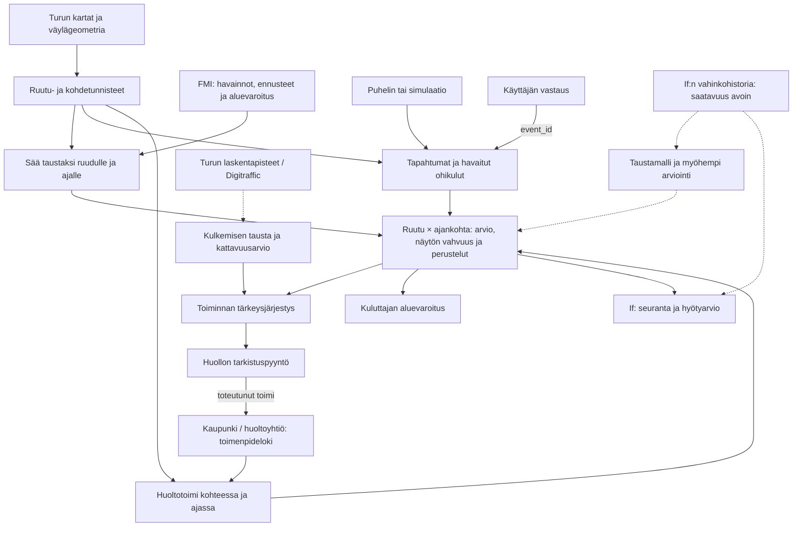

# Turun liukkauskartta: datalähteet ja niiden yhteydet

Ehdotus 17.10.2026. Pohjana käyttäjän ruudukkoluonnos ja aiempi suunnitelma.
Anturitapahtumat oletetaan saataviksi tai simuloitaviksi; tunnistimen
kehittäminen ei kuulu tähän rajaukseen. Lähteen olemassaolo, datan onnistunut
lataus ja valmiiksi koottu aineisto ovat eri valmiusasteita.

**Yhteinen rakenne on ruutu × ajankohta.** Pysyvä ruudukko antaa paikan,
tapahtumalokit kertovat mitä tapahtui, ja johdettu tilataulu kertoo mitä
palvelu saatavilla olevasta tiedosta päättelee. Samassa ruudussa voi olla
useita kulkuväyliä ja kunnossapidon vastaanottajia.

Katkoviiva tarkoittaa täydentävää tai saatavuudeltaan avointa kytkentää.
Vahinkohistoriaa käytetään sen tarkkuuden sallimalla tasolla. Huoltotehtävän
luominen ja toteutuneen huoltotoimen kirjaus ovat eri tapahtumia.

**Datalähteiden kartta.** Lähdeviitteet S1–S9 ovat lopussa.

| Data | Mistä | Millainen havainto | Rooli ja nykyinen valmius |
| --- | --- | --- | --- |
| Ruudukko | Itse muodostettu valitulle Turun alueelle | Pysyvä geometria ja `cell_id` | Ehdotus: noin 100 m ruutu. Tämä on laskennan valinta. |
| Kulkuväylät, rakennukset ja kohteet | Turun avoimet paikkatiedot; täydentäväksi Digitraffic Road Network [S1, S8] | Viiva, alue tai piste | Julkiset lähteet tunnistettu. Sopiva aineisto, kattavuus ja lataus tarkistettava. Vastuutietoa ei päätellä suoraan rakennuksen läheisyydestä. |
| Säähavainnot ja ennusteet | FMI [S2, S3] | Asema/hilaruutu ja aika | Turun historiallisen lämpötilan haku aiemmin testattu. Muiden suureiden saatavuus ja ennusteaineisto tarkistettava. |
| Alueellinen jalankulkusäävaroitus | FMI [S9] | Varoitusalue, syy ja voimassaolo | Julkinen varoitus on olemassa. Varoituksille kuvataan CAP-jakelutapa; jalankulkuvaroituksen poiminta ja historiallisen demon aineisto tarkistettava. Sopii mahdolliseksi lähtökerrokseksi. |
| Kiihtyvyys ja mahdollinen gyroskooppi | Käyttäjän saatavilla oleva aineisto tai simulaatio | Tiheä anturiaikasarja | Käyttäjän mukaan saatavilla; alkuperä ja lisenssi nimeämättä tässä kartassa. Turkuun siirretyn tallenteen paikka on simuloitu. |
| Kävely ja tapahtumapaikka | Puhelin tai simulaatio | Kävelyjakso, tapahtuma-aika, sijainti ja tarkkuus | Mahdollistaa tapahtumien kohdistuksen sekä sovelluksessa havaittujen ohikulkujen laskennan. Pelkät poikkeamat eivät kerro kävijämäärää. |
| Käyttäjän vastaus | Oma palvelu | Vastaus yksilöityyn tapahtumaan | Suunniteltu lähde, demossa simuloitava. Vastaus täydentää samaa tapahtumaa. |
| Jalankulkijoiden laskurit | Turun palvelukartta; Digitraffic counting-site [S1, S4, S5] | Laskentapisteen määrä tietyllä aikavälillä ja kulkutavalla | Viralliset palvelut kuvaavat myös Turun alueen laskureita. Tarkka pistekattavuus, puuttuvat jaksot ja jalankulun erottelu selvitettävä. |
| Hiekoitus, auraus ja tarkastukset | Turun kunnossapitotiedot, huoltoyhtiön loki tai simulaatio [S1, S6] | Toimenpidetyyppi, aika ja kohde/reitti | Kaupungin kartalla on kunnossapitotietoja; koneluettava toteutus ja yksityisten pihojen kattavuus avoinna. Demossa loki voidaan simuloida. |
| Historialliset vahingot | If:n kanssa sovittava aineisto [S7] | Vahinkotapahtuma tai alueellinen kooste | Ei käytössä tässä työssä. Julkiset ohjeet kertovat kerättävistä tiedoista, eivät sisäisen datan kattavuudesta. |
| Kaltevuus, pintamateriaali ja suojaisuus | Myöhemmin valittava maasto- tai kartta-aineisto | Kohteen hitaasti muuttuva ominaisuus | Jatkoidea paikallisen vaihtelun selittämiseen; aineistoa ei ole valittu tai ladattu. |

**Pysyvä tieto ja ajassa muuttuva tieto.**

- `grid_cell`: ruudun tunniste ja geometria, ruudukon versio.
- `site`: kulkuväylä, sisäänkäynti tai huoltokohde sekä varmennettu
  vastaanottaja. Yksi ruutu voi leikata useita kohteita.
- `weather_observation` ja `weather_forecast`: alkuperäiset säätiedot,
  joilla on oma paikkatarkkuus ja ajallinen merkitys.
- `sensor_event`: yksilöity tapahtuma, anturin pisteytys, sijaintitarkkuus,
  lähdetallenne, tapahtuma-aika ja palveluun saapumisaika.
- `observed_passage`: sovelluksessa havaittu ohikulku tai siitä muodostettu
  kooste; väestön kokonaismäärän arviota ei sekoiteta tähän.
- `confirmation`: viittaus tapahtumaan, kysymys, vastaus ja vastausaika.
- `maintenance_action`: toteutunut toimenpide, paikka/reitti, tapahtuma- ja
  kirjausaika. Tehtävän tilat pidetään erillään tästä.
- `claim`: vahingon tapahtuma- ja ilmoitusaika, syy, paikan tarkkuus ja
  mahdollinen kustannus. Kokoaminen riippuu If:n aineistosta.
- `cell_state`: edellisistä laskettu tilanne tiettynä arviointihetkenä.
- `source_registry`: alkuperä, aineistoversio, käyttöehdot, päivitys ja
  tieto siitä, mikä osa on oikeaa ja mikä simuloitua.

”Historialliset vahingot” ja ”milloin hiekoitettu” ovat ruudulle laskettavia
ominaisuuksia erillisistä tapahtumista. Ne eivät ole ruudun pysyviä metatietoja.

**Miten tiedot yhdistetään käytännössä.**

1. **Paikka:** ruuduta valittu alue metreihin perustuvassa
   koordinaatistossa. Kohdista tapahtuman sijainti ruutuun. Säilytä
   sijaintitarkkuus; epätarkkaa tapahtumaa ei pakoteta tarkalle pihalle.
2. **Kohde:** yhdistä kulkuväylä ja huollon toimenpide geometrian tai
   varmennetun kohdetunnisteen kautta. Pelkkä sama ruutu ei todista, että
   toimenpide koski kaikkia ruudun kulkuväyliä.
3. **Aika:** käytä esimerkiksi 15 minuutin arviointihetkiä. Laske
   tapahtumat ja sovelluksen ohikulut samalta tarkasteluikkunalta,
   esimerkiksi edeltäviltä kahdelta tunnilta. Ikkuna on säädettävä valinta.
4. **Saatavuus:** säilytä tapahtuma-aika ja tiedon saapumisaika.
   Käyttäjän myöhempi vastaus vaikuttaa vasta saapumisestaan alkaen.
   Ennusteeseen tarvitaan voimassaoloajan lisäksi julkaisuhetki.
5. **Sää:** kohdista sopiva asema tai ennustehila. Säilytä lähdetunniste.
   Sama asemamittaus voi koskea monia ruutuja; se ei tee säästä
   ruutukohtaisesti mitattua tai ruuduista riippumattomia havaintoja.
6. **Koosteet:** kokoa kukin lähde erikseen avaimelle
   `(cell_id, evaluation_at)` ja yhdistä koosteet. Raakojen tapahtuma-,
   sää- ja huoltorivien suora monen suhde moneen -liitos voi monistaa
   tapahtumamäärät.
7. **Historia:** osoitetason tai aluetasoiset vahingot kohdistetaan vain
   tarkkuutensa sallimalle tasolle. Mallin opetus ja arviointi erotetaan
   ajallisesti. Tulevia vahinkoja ei käytetä menneisyyden ennustamiseen.

**Ruudulle laskettavat tiedot.**

| Ryhmä | Esimerkkikentät | Tulkinta |
| --- | --- | --- |
| Säätausta | `air_temp_c`, `rain_recent_mm`, `weather_source_id`, `forecast_issued_at` | Käytetyt suureet ja lähde; ilman lämpötila ei ole tienpinnan lämpötila. |
| Tapahtumat | `candidate_events_2h`, `confirmed_slips_2h`, `reported_falls_2h` | Liukastuminen ja kaatuminen erotetaan. Sama vahvistettu anturitapahtuma lasketaan vain kerran tapahtumien kokonaismäärään. |
| Altistus | `app_observed_passages_2h`, `counter_passages`, `coverage_status` | Sovelluksen otos ja ulkoisen laskurin lukema säilyvät erillisinä. |
| Huolto | `last_known_gritting_at`, `maintenance_coverage`, `task_status` | Tunnettu toimi, sen kohdistus ja mahdollinen tarkistuspyyntö. |
| Historia | `historical_claims`, `history_spatial_resolution`, `history_period` | If:n havaittu vahinkohistoria käytettävissä olevalla tarkkuudella. |
| Päätelmä | `hazard_index`, `evidence_level`, `maintenance_priority`, `reasons` | Vaaran suhteellinen arvio, näytön vahvuus ja huollon tärkeysjärjestys erikseen. |
| Alkuperä | `as_of`, `model_version`, `source_ids`, `is_simulated` | Mistä tieto on tullut ja milloin se oli käytettävissä. Tarvittaessa alkuperä merkitään kenttäkohtaisesti. |

Puuttuva ohikulkumäärä, tuntematon huolto ja nolla havaintoa ovat eri asioita.
`last_known_gritting_at = null` tarkoittaa, ettei hiekoituksesta ole tietoa.
Se ei tarkoita, ettei hiekoitusta ole tehty.

**Kolme erilaista varmuutta.**

Anturin mallipisteytys kuvaa tunnistimen tulosta. Sitä voi kutsua
todennäköisyydeksi vasta, jos kyseinen tulkinta on kalibroitu sopivalla
aineistolla. Käyttäjän vahvistus on itse ilmoitettu havainto, ei toinen
riippumaton tapahtuma. Ruudun näytön vahvuus puolestaan riippuu tuoreudesta,
peitosta, riippumattomista havainnoista ja paikannuksesta.

Kaupungin laskurin kokonaismäärä ei sellaisenaan sovi sovelluksen
anturitapahtumien jakajaksi: vain osa ohikulkijoista käyttää sovellusta.
Ulkoinen laskuri voi auttaa arvioimaan otoksen kattavuutta ja huollon
mahdollisesti tavoittamien ihmisten määrää. Laskentapiste ei myöskään mittaa
automaattisesti ympäröivien ruutujen kulkemista.

**Mitä tästä kannattaa toteuttaa ensin.**

Muodosta ruudukko ja yksi säätausta. Lisää tapahtumat, sovelluksessa havaitut
ohikulut ja simuloitu huoltoloki. Rakenna sitten ruudun tilannekuva ja
aikajanan toisto. Käyttäjän vastaukset lisätään tapahtumaviitteellä.
If:n historiadata ja kaupungin laskurit voivat täydentää kokonaisuutta niiden
saatavuuden tarkentuessa; niitä ei tarvitse keksiä valmiiksi.

Selvitä myös valmiin alueellisen jalankulkusäävaroituksen käyttö lähtökerroksena.
Se voi vähentää tarvetta kehittää omaa sääperusteista liukkausmallia. Paikalliset
havainnot täydentäisivät aluevaroitusta. Varoituksen puuttuminen ei osoita,
että yksittäinen piha tai kulkuväylä olisi pitävä.

Kolme kokeiltavaa palveluideaa:

- **Huollon jälkeen jatkuvat havainnot:** tarkistuspyyntö, jos samalla
  kulkuväylällä kertyy tuoretta näyttöä toimenpiteen jälkeen. Myös
  mahdollinen kohdistusvirhe ja havaintojen viive huomioidaan.
- **Kysy silloin, kun vastauksella on merkitystä:** verrataan kyselyjen
  määrää ja luokituksen tai toiminnan muuttumista. Vastaamatta jättäminen
  säilyy puuttuvana tietona.
- **Uuden asuinalueen ensimmäinen talvi:** käyttäjä valitsee oman alueen
  tai kulkureitin. Paikalliset varoitukset ja huollolle välittyvät havainnot
  muodostavat näkyvän asiakashyödyn.

**Lähteet ja tarkistusten rajat.**

- S1: [Turun kartat ja paikkatieto](https://www.turku.fi/tietoa-turusta/kartat-ja-paikkatieto).
  Kaupunki kuvaa avoimet paikkatietopalvelut, laskentapisteet ja
  kunnossapitotietojen karttanäkymän. Aiempi WFS-koepyyntö palautti tästä
  ympäristöstä HTTP 403. Aineistokohtainen lataus ja sopivuus ovat avoinna.
- S2: [FMI:n avoin data](https://www.ilmatieteenlaitos.fi/avoin-data).
  Aiempi 17.10.2026 tehty lämpötilakysely palautti Turku Artukaisen
  historiallisia havaintoja. Laajempaa sääaineistoa ei ole koottu.
- S3: [FMI:n jalankulkusäämalli](https://www.ilmatieteenlaitos.fi/jalankulkusaamalli).
  Monen päivän säätausta ja useat sääsuureet ovat olennaisia.
  FMI:n jalankulkuindeksin avointa saatavuutta ei ole vahvistettu.
- S4: [Turun palvelukartan kävelynäkymä](https://palvelukartta.turku.fi/fi/mobility/walking).
  Näkymä sisältää laskentapisteitä sekä kävelyyn liittyviä karttatasoja.
- S5: [Digitrafficin tieliikenteen dokumentaatio](https://www.digitraffic.fi/en/road-traffic/#walking-and-cycling-counting-site-values).
  Dokumentaatio nimeää Turun ja Oulun laskentadatan lähdealueiksi sekä
  `counting-site/v2/sites`- ja `counting-site/v2/values`-rajapinnat.
  Tämän työn suorat metatietopyynnöt palauttivat HTTP 406, myös
  JSON-vastaustyypin pyynnön jälkeen. Laskuridataa ei ole ladattu tai
  Turun yksittäisiä pisteitä varmistettu tässä työssä.
- S6: [Turun talvikunnossapito](https://www.turku.fi/talvi-ei-paase-yllattamaan-turussa-nain-valmistaudumme-talvikunnossapitoon).
  Kaupungin ja kiinteistöjen vastuut sekä palvelukartalla näkyvä auraus ja hiekoitus.
- S7: [If:n liukastumisselvitys](https://www.if.fi/yritysasiakkaat/ilmoita-vahingosta/henkilovahinko/ammattitauti/selvitys-liukastumisesta).
  Julkisessa lomakkeessa kysytään tarkkaa osoitetta ja olosuhdetietoja.
  Tämä ei varmista tiedon kattavuutta sisäisessä vakuutusaineistossa.
- S8: [Digitraffic Road Network](https://www.digitraffic.fi/en/road-traffic/road-and-street-network/).
  Nykyinen tie- ja katuverkon dokumentaatio. [Fintrafficin vanha
  Digiroad-sivu](https://www.fintraffic.fi/fi/digitaalisetpalvelut-4) ilmoittaa
  Digiroad-palvelun päättyneen 30.9.2026; vanhojen latausohjeiden nykytila
  pitää tarkistaa ennen toteutusta. Kävelyväylien riittävä tarkkuus arvioidaan
  erikseen valitulta alueelta.
- S9: [FMI:n jalankulkusää](https://www.ilmatieteenlaitos.fi/jalankulkusaa) ja
  [avoimen datan pikaohje](https://www.ilmatieteenlaitos.fi/avoin-data-pikaohje).
  Jalankulkusäävaroitus koskee erittäin liukkaita kelejä, ja paikallista
  vaihtelua voi olla. Pikaohje kuvaa säävaroitusten jakamisen CAP-syötteenä.
  Jalankulkuvaroitusta ei ole haettu tai luettu ohjelmallisesti tässä työssä.
